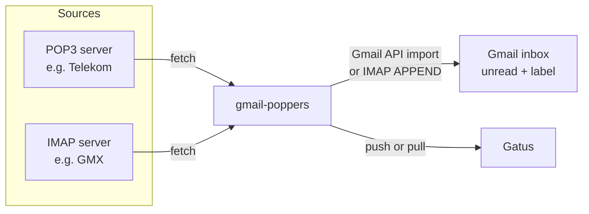

# gmail-poppers

Google is discontinuing Gmail's ability to fetch mail from other accounts via
POP3 ("Check mail from other accounts"). **gmail-poppers** replaces that
feature: a small self-hosted service that regularly fetches mail from your
other mailboxes (POP3 or IMAP) and puts it into Gmail, in the inbox and
marked as unread, as if Gmail had fetched it itself.

- Multiple Gmail accounts, each with any number of POP3/IMAP sources.
- Runs as a single Docker container, configured with one YAML file.
- Each source shows up separately in [Gatus](https://github.com/TwiN/gatus),
  including the exact error message when something breaks.
- A dry-run mode to test all connections without changing anything.

Inspired by [gmail-importer3](https://github.com/kyokuheki/gmail-importer3).

## How it works



For every source, gmail-poppers runs this loop:

1. Connect to the mail server. TLS is detected automatically.
2. List all messages and skip those it has already handled. It remembers them in `/data/state`.
3. Insert each new message into Gmail with the labels **INBOX** and **UNREAD**, plus an optional label such as `telekom`.
4. Optionally delete the message on the source server.
5. Report the result to Gatus and to the web UI.

## Features

| | |
|---|---|
| Sources | POP3 and IMAP. IMAP can use several folders per source (default `INBOX`). |
| Writing to Gmail | `api`: Gmail API `messages.import`, recommended. `imap`: IMAP `APPEND` with an app password. |
| TLS | `auto` detection, or explicitly `implicit`, `starttls` or `none` |
| After import | Keep the mail on the server (default) or delete it (`delete_after_import`) |
| First run | `new_only` (default): mail that is already on the server is not imported. `all`: everything is imported. |
| Duplicates | Detected by UID/UIDL and Message-ID |
| Monitoring | Gatus push (external endpoints), pull (HTTP status endpoints), or both |
| Dry run | `DRY_RUN=true` connects and authenticates everywhere but only reads |
| Secrets | `${VAR}` references in the config, resolved from environment variables |

## Quick start

1. Create a directory on the Docker host, e.g. `/opt/gmail-poppers/config`.
2. Copy [config.example.yaml](config.example.yaml) to `/opt/gmail-poppers/config/config.yaml` and adjust it.
3. If you use `method: api`, follow [Google Cloud setup](#google-cloud-setup-method-api) and save the
   client file as `/opt/gmail-poppers/config/client_secret.json`.
4. Deploy [docker-compose.yml](docker-compose.yml) as a Portainer stack. Set the
   referenced variables (`GATUS_TOKEN`, `UI_BASIC_AUTH`, mailbox passwords, …)
   in the stack's environment variables.
5. Start with `DRY_RUN: "true"` and open `http://<host>:8080`.
6. Authorize every Gmail account that uses `method: api`. See [Authorizing Gmail accounts](#authorizing-gmail-accounts).
7. When every source shows **OK**, set `DRY_RUN: "false"` and redeploy.

### Docker image

Prebuilt multi-arch images (`linux/amd64`, `linux/arm64`, `linux/arm/v7`,
so they also run on a Raspberry Pi) are published to the GitHub Container
Registry:

| Tag | Built from |
|---|---|
| `latest`, `main` | the `main` branch |
| `1.2.3`, `1.2` | git tags `v1.2.3` |
| `sha-<commit>` | every pushed commit |

In [docker-compose.yml](docker-compose.yml), replace `build: .` with
`image: ghcr.io/konqi/gmail-poppers:latest`. If the package is private, log
in to `ghcr.io` in Portainer first (**Registries → Add registry**).

To build the image yourself:

```sh
docker build -t gmail-poppers:latest .
```

## Google Cloud setup (method `api`)

The Gmail API needs an OAuth client. You create it once in your own Google
Cloud project and can use it for all of your Gmail accounts. Google renames
menu entries from time to time, so the names below may differ slightly.

1. Open <https://console.cloud.google.com/> and create a new project, e.g. `gmail-poppers`.
2. **APIs & Services → Library**: search for **Gmail API** and click **Enable**.
3. **Google Auth Platform** (formerly "OAuth consent screen") → **Get started**:
   - App name: `gmail-poppers`, user support email: your address
   - Audience: **External**
   - Contact email: your address
4. **Audience**: click **Publish app** so the status becomes **In production**.
   > ⚠️ This step matters. While the app is in *Testing*, Google lets
   > refresh tokens expire after 7 days and imports stop working. A
   > production app that was never verified is fine for personal use. You
   > will only see an "unverified app" warning when you authorize.
5. **Clients → Create client**:
   - Application type: **Desktop app**
   - Name: `gmail-poppers`
   - Download the JSON file and store it as `/opt/gmail-poppers/config/client_secret.json`.

The service requests these scopes:

| Scope | Purpose |
|---|---|
| `gmail.insert` | Insert messages into the mailbox (it cannot read your mail) |
| `gmail.labels` | Look up and create the per-source label |
| `openid`, `email` | Check that you signed in with the right Google account |

Instead of the file, you can set `GOOGLE_CLIENT_ID` and `GOOGLE_CLIENT_SECRET`.

## Authorizing Gmail accounts

The same binary is both the service and the OAuth CLI: without arguments it
runs the service; `gmail-poppers auth` authorizes one account without starting
the service or reading the service YAML. Both the CLI and web flow are supported.
Use one Google Cloud project and one **Desktop app** OAuth client for all your
Gmail accounts, but authorize each account separately.

### CLI on your laptop (recommended for Raspberry Pi / Portainer)

Run the CLI on the computer where you use your browser, not inside the RPi
container. Build the binary locally with Go (on Windows, use
`-o gmail-poppers.exe`):

```sh
go build -o gmail-poppers ./cmd/gmail-poppers
./gmail-poppers auth --account private@gmail.com --client-secret ./client_secret.json --token-dir ./tokens
./gmail-poppers auth --account second@gmail.com --client-secret ./client_secret.json --token-dir ./tokens
```

For each command, the browser opens Google sign-in. Sign in as the requested
account and grant access. The CLI receives the callback on a temporary port
bound only to `127.0.0.1`, checks the account, and saves its token file with mode
0600. There is no URL to paste. If the browser does not open, open the printed
URL manually **on the same computer**. `--no-browser` disables automatic browser
launch; `auth --help` lists the options. Authorization times out after five
minutes and can be cancelled with Ctrl+C.

Transfer the generated files securely to the RPi, for example with `scp`:

```sh
ssh pi@raspberrypi 'mkdir -p ~/gmail-poppers-tokens && chmod 700 ~/gmail-poppers-tokens'
scp ./tokens/*.token.json pi@raspberrypi:~/gmail-poppers-tokens/
```

On the RPi, stop the container before replacing tokens for an existing account.
Move the files into a dedicated directory and give the container's nonroot user
(UID/GID 65532) access. Run these commands yourself on the RPi:

```sh
sudo mkdir -p /opt/gmail-poppers/tokens
sudo cp ~/gmail-poppers-tokens/*.token.json /opt/gmail-poppers/tokens/
sudo chown -R 65532:65532 /opt/gmail-poppers/tokens
sudo chmod 700 /opt/gmail-poppers/tokens
sudo chmod 600 /opt/gmail-poppers/tokens/*.token.json
rm ~/gmail-poppers-tokens/*.token.json
```

Add the token mount and environment variable to the service in your Portainer
stack (keep its other mounts and settings):

```yaml
environment:
  TOKEN_DIR: /tokens
  GOOGLE_CLIENT_SECRET_FILE: /config/client_secret.json
volumes:
  - /opt/gmail-poppers/tokens:/tokens
```

Mount the same OAuth client JSON read-only under `/config` as before. The service
still needs that client to refresh tokens. The token mount must be **writable**
because refreshed tokens are saved there automatically. Add each Gmail address
to `accounts` in your YAML with `method: api`; do not paste tokens into the YAML.
Start or redeploy the container after copying tokens. No SSH tunnel, public
callback URL, or browser on the RPi is required.

Keep the token files private: they grant access to the corresponding Gmail
account. To re-authorize later, repeat the CLI flow and replace that account's
file while the service is stopped, then restart it. The web flow below can also
re-authorize an account directly on the service.

### Web UI (alternative)

Each Gmail account with `method: api` can also be authorized in the service UI:

1. Open the web UI (`http://<host>:8080`) and click **Authorize** next to the account.
2. Click **Open the Google sign-in page** and sign in with that Gmail account.
   Accept the "unverified app" warning (**Advanced → Go to gmail-poppers**).
3. After you grant access, Google redirects to `http://127.0.0.1:53682/…`.
   That page fails to load, **which is expected**, because nothing listens there.
4. Copy the **complete URL** from the browser's address bar, paste it into the
   form and click **Finish authorization**.

The token is stored in `TOKEN_DIR` (default `/data/tokens`) as
`<gmail>.token.json` (mode 0600) and is refreshed automatically. Both flows use
the same token format. If you signed in with a different Google account
than the one being authorized, the authorization is rejected.

## Alternative: method `imap`

With `method: imap`, gmail-poppers logs in to `imap.gmail.com` with an
[app password](https://myaccount.google.com/apppasswords). This requires
2-step verification on the Google account. No Google Cloud project is needed.

> ⚠️ **No spam filtering.** Messages inserted via IMAP `APPEND` skip Gmail's
> spam and malware scanning and always land in the inbox. With `method: api`,
> Gmail scans imported messages like normally received mail. Use `imap` only
> if you cannot use the API.

## Configuration reference

See [config.example.yaml](config.example.yaml) for a complete example.

### `defaults`

| Field | Default | Description |
|---|---|---|
| `interval` | `5m` | Time between two runs of a source (minimum `10s`) |
| `timeout` | `10m` | Maximum duration of one run |
| `initial_sync` | `new_only` | `new_only` or `all`, see [State and first run](#state-and-first-run) |

### `accounts.<gmail address>`

| Field | Default | Description |
|---|---|---|
| `method` | `api` | `api` or `imap` |
| `app_password` | | Required for `method: imap` |
| `sources` | | Map of sources, keyed by a short name |

### `accounts.<gmail address>.sources.<name>`

| Field | Default | Description |
|---|---|---|
| `type` | *required* | `pop3` or `imap` |
| `server` | *required* | Hostname of the mail server |
| `port` | depends on `tls` | POP3: 995 / 110, IMAP: 993 / 143 |
| `tls` | `auto` | `auto`, `implicit`, `starttls` or `none` |
| `user` | *required* | Login name |
| `password` | *required* | Password, ideally `${ENV_VAR}` |
| `folders` | `[INBOX]` | IMAP only: folders to fetch |
| `delete_after_import` | `false` | Delete messages on the server after a successful import |
| `label` | source name | Gmail label to add; `""` adds no label |
| `interval` | `defaults.interval` | Polling interval for this source |
| `timeout` | `defaults.timeout` | Run timeout for this source |
| `initial_sync` | `defaults.initial_sync` | `new_only` or `all` |

Unknown fields are reported as errors, so typos don't go unnoticed.

## Environment variables

| Variable | Default | Description |
|---|---|---|
| `CONFIG_PATH` | `/config/config.yaml` | Path to the configuration file |
| `DATA_DIR` | `/data` | State and OAuth tokens. Mount a volume here. |
| `TOKEN_DIR` | `${DATA_DIR}/tokens` | Override token storage, shared by the service and web UI. CLI default: `./tokens`. |
| `HTTP_ADDR` | `:8080` | Listen address of the web UI and status endpoints |
| `DRY_RUN` | `false` | `true`: read only, see [Dry run](#dry-run) |
| `GATUS_MODE` | `pull` | `pull`, `push` or `both` |
| `GATUS_URL` | | Base URL of Gatus, required for `push`/`both` |
| `GATUS_TOKEN` | | Bearer token of the Gatus external endpoints |
| `GOOGLE_CLIENT_SECRET_FILE` | | Path to the downloaded OAuth client JSON |
| `GOOGLE_CLIENT_ID`, `GOOGLE_CLIENT_SECRET` | | Alternative to the client file |
| `UI_BASIC_AUTH` | | `user:password` protecting the web UI |
| `LOG_LEVEL` | `info` | `debug`, `info`, `warn` or `error` |

Any other variable can be referenced from the config as `${NAME}`.

## Gatus integration

Every source becomes its own Gatus endpoint. The Gmail address is the
**group** and the source name is the **name**. The web UI page **/gatus**
shows ready-to-paste configuration for your setup.

### Push (`GATUS_MODE=push`)

After every run, gmail-poppers calls Gatus' external endpoint API. If the run
failed, the error message is included, e.g.
`pop3 login: server: [AUTH] invalid credentials`. The heartbeat marks a
source as failing if gmail-poppers stops reporting altogether.

```yaml
external-endpoints:
  - name: "telekom"
    group: "mymail@gmail.com"
    token: "${GMAIL_POPPERS_GATUS_TOKEN}"
    heartbeat:
      interval: 25m0s
```

Set `GMAIL_POPPERS_GATUS_TOKEN` in Gatus' environment to the same value as
`GATUS_TOKEN` in gmail-poppers. At startup, the snippet is also printed to the log.

### Pull (`GATUS_MODE=pull`)

gmail-poppers serves `GET /status` (all sources) and
`GET /status/<gmail>/<source>`. They return HTTP 200 when the source is
healthy and 503 otherwise. A source also counts as unhealthy if its last run
is older than 3 × interval + timeout.

```yaml
endpoints:
  - name: "telekom"
    group: "mymail@gmail.com"
    url: "http://gmail-poppers:8080/status/mymail@gmail.com/telekom"
    interval: 5m0s
    conditions:
      - "[STATUS] == 200"
      - "[BODY].message == ok"
```

If a check fails, Gatus shows the actual value of `[BODY].message`, which
is the error message.

## Dry run

With `DRY_RUN=true`, gmail-poppers performs every run as usual but only reads:

- **Sources:** login, list messages and read **headers only** (POP3 `TOP`,
  IMAP `BODY.PEEK[HEADER]` on a read-only `EXAMINE`d folder). Nothing is deleted
  or flagged.
- **Gmail:** authentication is checked and labels are listed. Nothing is
  imported and no labels are created.
- **State:** nothing is saved, so a later real run starts from scratch.
- The log shows what *would* happen, e.g. `dry run: would import` with sender
  and subject, `would delete`, `would create Gmail label`.

Status and Gatus reporting work as usual, so you can verify the whole setup,
including credentials and TLS, before importing anything. The OAuth
authorization in the web UI also works in dry-run mode.

## State and first run

gmail-poppers stores the progress of every source as JSON in `/data/state`.
Keep `/data` on a persistent volume, or it will treat mail as new again after
a container is recreated.

- `initial_sync: new_only` (default): on the very first run, all messages
  already on the server are only **marked as seen**. Use this if Gmail
  fetched the account before with "leave a copy on the server", so you don't
  get duplicates.
- `initial_sync: all`: imports everything that is on the server.
- With `delete_after_import: false`, messages stay on the server. Messages
  that disappear from the server are removed from the state.
- Only messages that gmail-poppers imported itself are deleted, never the
  ones marked as seen on the first run.
- If Gmail rejects a single message 3 times (e.g. too large), it is skipped
  and the run is reported as failed with the reason.

## TLS auto-detection

With `tls: auto`:

| Port | Behavior |
|---|---|
| 993 / 995 | Implicit TLS |
| 143 / 110 | STARTTLS, must be offered by the server |
| not set | Try implicit TLS on 993/995, then STARTTLS on 143/110 |
| other | Try implicit TLS, then STARTTLS on that port |

Certificates are always verified. gmail-poppers **never** falls back to an
unencrypted connection unless you explicitly set `tls: none`.

## Troubleshooting

| Error | What to do |
|---|---|
| `gmail api: account not authorized yet` | Authorize the account in the web UI |
| `gmail api: authorization expired or revoked` | Re-authorize. Make sure the OAuth app is **In production**. |
| `gmail api: no OAuth client configured` | Set `GOOGLE_CLIENT_SECRET_FILE` and mount the file |
| `gmail imap login (check the app password)` | Create a new app password for the Gmail account |
| `pop3 login: server: …` / `imap login: …` | Wrong user or password, or POP3/IMAP access is disabled at the provider |
| `tls auto-detection failed: …` | The server doesn't support TLS on that port. Check `port`/`tls`. |
| `x509: certificate …` | The server certificate is invalid. Check the `server` hostname. |
| `stale: last run at …` | gmail-poppers is hanging or was stopped. Check the container logs. |

Set `LOG_LEVEL=debug` for more details.

## Security notes

- Don't expose the web UI to the internet. Use it in your LAN and set `UI_BASIC_AUTH`.
- The `/status` and `/healthz` endpoints are not password-protected, so Gatus and
  Docker can reach them. They only contain status and error messages.
- Mount the config read-only and keep passwords in environment variables.
- OAuth tokens in `/data/tokens` give write access (insert only) to your
  Gmail. Protect the volume accordingly.
- The container runs as a non-root user on a distroless base image.

## Development

```sh
go test ./...
go vet ./...
go run ./cmd/gmail-poppers   # with CONFIG_PATH, DATA_DIR, … set
```

The [CI workflow](.github/workflows/ci.yml) runs on every pull request and
push. It checks `gofmt`, `go mod tidy`, `go vet`, `staticcheck` and
`govulncheck`, then runs the tests with the race detector and builds the
Docker image for all platforms. Images are pushed only for `main` and `v*`
tags.

See [AGENTS.md](AGENTS.md) for conventions.

## License

[MIT](LICENSE)
