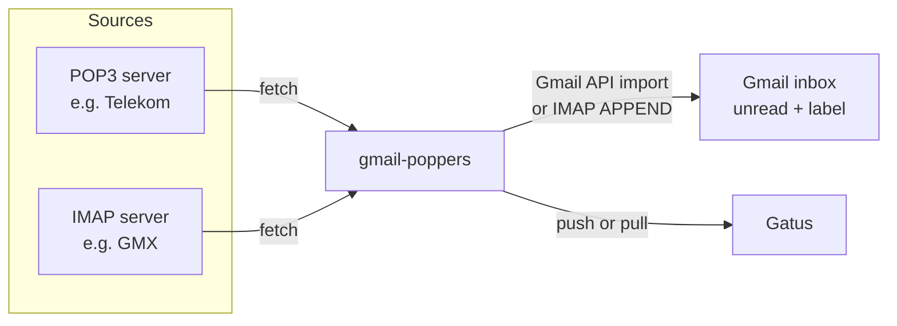

# gmail-poppers

Google is discontinuing Gmail's ability to fetch mail from other accounts via
POP3 ("Check mail from other accounts"). **gmail-poppers** replaces that
feature: a small self-hosted service that regularly fetches mail from your
other mailboxes (POP3 or IMAP) and puts it into Gmail, in the inbox and
marked as unread, as if Gmail had fetched it itself.

> **AI disclosure:** This service is effectively 100% vibe coded with AI.
> The author needed a solution to a practical problem, and no existing tool
> fitted the bill for this setup. If you object to AI-generated software for
> ethical or any other reasons, you are entirely free not to use it.

- Multiple Gmail targets, each with any number of POP3/IMAP sources.
- Runs as a single Docker container, configured with one YAML file.
- Each source shows up separately in [Gatus](https://github.com/TwiN/gatus),
  including the exact error message when something breaks.
- A dry-run mode to test all connections without changing anything.

Inspired by [gmail-importer3](https://github.com/kyokuheki/gmail-importer3).

## How it works



For every source, gmail-poppers runs this loop:

1. Wait for a slot on the Gmail target, then connect to the mail server. TLS is detected automatically.
2. List all messages and skip those it has already handled. It remembers them in `/data/state`.
3. Insert each new message into Gmail with the labels **INBOX** and **UNREAD**, plus an optional label (the source email by default).
4. Optionally delete the message on the source server.
5. Report the result to Gatus and the read-only JSON status endpoints.

## Features

| | |
|---|---|
| Sources | POP3 and IMAP. IMAP can use several folders per source (default `INBOX`). |
| Writing to Gmail | `api`: Gmail API `messages.import`, recommended. `imap`: IMAP `APPEND` with an app password. |
| TLS | `auto` detection, or explicitly `implicit`, `starttls` or `none` |
| After import | Keep the mail on the server (default) or delete it (`delete_after_import`) |
| First run | `new_only` (default): mail that is already on the server is not imported. `all`: everything is imported. |
| Duplicates | Detected by UID/UIDL and Message-ID |
| Monitoring | Gatus push (external endpoints), pull (HTTP status endpoints), or both |
| Dry run | `DRY_RUN=true` connects and authenticates everywhere but only reads |
| Secrets | `${VAR}` references resolved from environment variables or an explicitly loaded dotenv file |

## Quick start

1. On your browser computer, build the CLI and follow [Google Cloud setup](#google-cloud-setup-method-api)
  for API targets. Keep the client JSON as `./client_secret.json`.
2. Use [Local setup](#local-setup) to authorize targets, add sources and link them.
3. Transfer the generated YAML, dotenv and client JSON securely into
  `/opt/gmail-poppers/config` on the Docker host. Install tokens as described
  in [Authorizing Gmail accounts](#authorizing-gmail-accounts).
4. Give the container's UID/GID 65532 read access to that private config directory
  and its files; do not make secrets world-readable.
5. Deploy [docker-compose.yml](docker-compose.yml) as a Portainer stack, using
  the [dotenv settings below](#dotenv-and-portainer). Set `GATUS_TOKEN` in
  Portainer and keep the persistent `/data` volume.
6. Start with `DRY_RUN: "true"` and check the container logs or Gatus.
7. When every source reports success, set `DRY_RUN: "false"` and redeploy.

### Local setup

Calling the binary without arguments starts the service when setup is complete.
If configuration, targets, sources, routes or required API authorization are
missing, it prints the corresponding `add`, `link` or `auth` commands and exits
with code 1. The readiness check does not create files, open a status listener,
or contact mail servers. Invalid YAML is reported as a configuration error.

Run these commands locally, before enabling service dry run. Set `MY_PASS` in
your process environment or the local dotenv file to the source password;
never put a real password into the example command.

```sh
go build -o gmail-poppers ./cmd/gmail-poppers
./gmail-poppers auth --account mymail@gmail.com
./gmail-poppers add target mymail@gmail.com --non-interactive
./gmail-poppers add source me@example.com --type pop3 --server pop.example.com --password-env MY_PASS --non-interactive
./gmail-poppers link me@example.com mymail@gmail.com --non-interactive
```

Then start locally with `ENV_FILE=./.env ./gmail-poppers` when using generated
dotenv secrets, or `./gmail-poppers` when values are already in the environment
or YAML. Local service defaults are `./config.yaml`, `./data`, and `./tokens`;
the Docker image sets `/config/config.yaml` and `/data` instead. If `DATA_DIR`
is explicitly set, the service defaults token storage to `${DATA_DIR}/tokens`.

`auth`, `add`, `link` and `test` default to `./config.yaml`,
`./client_secret.json` and `./tokens`. `--config`, `--client-secret` and
`--token-dir` override them; `CONFIG_PATH`, `GOOGLE_CLIENT_SECRET_FILE` and
`TOKEN_DIR` can also supply those paths. Flags may appear before or after
positional arguments. The dotenv default is `.env` beside the config;
an explicit `--env-file` path must already exist. Process environment values
override dotenv values.

The option is named `--client-secret`, while the default input file is
`client_secret.json` (with an underscore). This file is only read; account
tokens are saved separately in the token directory.

Without `--non-interactive`, `add` prompts for missing information. An API
target uses `--mode api` (default); interactive setup authorizes it if needed,
stages the token, checks access, then saves locally. Non-interactive API setup
requires an existing token from `auth`. For an IMAP target, use `--mode imap`
and supply its app password.

For sources, `--type pop3|imap` selects the protocol (`--mode` is an alias).
Settings are `--server`, `--port` (default auto), `--tls` (default `auto`),
`--user` (default source email), `--folders` (comma-separated, IMAP only,
default `INBOX`), `--interval` and `--timeout`. The last two inherit config
defaults, otherwise `5m` and `10m`. `--check-timeout` defaults to `30s`.
`--non-interactive` never prompts: defaults are permitted, but missing source
type, server or password fails before connecting.

Choose exactly one of `--password-env`, `--password-file` or `--password`;
prefer the first two to avoid exposing secrets in command history or process
arguments. `--secret-storage env` (default) writes a generated password variable
to dotenv and a `${VAR}` reference to YAML; `--secret-storage yaml` stores the
password in YAML. Generated YAML and dotenv files have mode 0600. `add` saves
only after a read-only server check; OAuth consent changes authorization
metadata and local tokens, not mailbox contents.

`link <source-email> <target-email>` only changes local YAML, without network
access. Options are `--label` (`--label=""` disables the extra label),
`--initial-sync new_only|all` and `--delete-after-import=true|false`.
With `--non-interactive`, omitted options use defaults for a new route or
retain existing options. Linking an already routed source to another target
is rejected. Each source has one target per instance; many sources can share
a target. `DRY_RUN=true` refuses setup writes, including `auth` and `link`.

### Dotenv and Portainer

The service does **not** automatically load the CLI's local dotenv file.
Mount the entire config directory read-only (including `.env`) and add:

```yaml
environment:
  ENV_FILE: /config/.env
  GOOGLE_CLIENT_SECRET_FILE: /config/client_secret.json
volumes:
  - /opt/gmail-poppers/config:/config:ro
  - gmail-poppers-data:/data
```

This is an addition to the example stack, which stays in push mode without a
published host port. Remove its sample `TELEKOM_PASSWORD` and `GMX_PASSWORD`
entries unless your YAML actually references them. Alternatively, enter the
decoded variable values manually in Portainer and omit `ENV_FILE`.

`ENV_FILE` uses the same dotenv parser as the CLI; process environment values
win. Generated values are **JSON-quoted**, preserving dollar signs and escape
sequences. **Do not source this file in a shell or pass it directly as Compose
`env_file`**: complex values, especially those containing `$`, can be changed
by different parsing or interpolation rules. Keep generated `.env` separate
from Compose's automatic interpolation file.

### Docker image

Prebuilt images for `linux/amd64`, `linux/arm64` and `linux/arm/v7`
(including Raspberry Pi) are published to the GitHub Container Registry:

| Tag | Built from |
|---|---|
| `latest`, `main` | the `main` branch |
| `1.2.3`, `1.2` | git tags `v1.2.3` |
| `sha-<commit>` | every pushed commit |

In [docker-compose.yml](docker-compose.yml), remove `build: .` and set
`image: ghcr.io/konqi/gmail-poppers:latest`. If the package is private, log
in to `ghcr.io` in Portainer first (**Registries → Add registry**).

To build the image yourself:

```sh
docker build -t gmail-poppers:latest .
```

## Google Cloud setup (method `api`)

The Gmail API needs an OAuth client. You create it once in your own Google
Cloud project and can use it for all of your Gmail accounts. Google renames
menu entries from time to time, so the names below may differ slightly.

1. Open <https://console.cloud.google.com/> and create a new project, e.g. `gmail-poppers`.
2. **APIs & Services → Library**: search for **Gmail API** and click **Enable**.
3. **Google Auth Platform** (formerly "OAuth consent screen") → **Get started**:
   - App name: `gmail-poppers`, user support email: your address
   - Audience: **External**
   - Contact email: your address
4. **Audience**: click **Publish app** so the status becomes **In production**.
   > ⚠️ This step matters. While the app is in *Testing*, Google lets
   > refresh tokens expire after 7 days and imports stop working. A
   > production app that was never verified is fine for personal use. You
   > will only see an "unverified app" warning when you authorize.
5. **Clients → Create client**:
   - Application type: **Desktop app**
   - Name: `gmail-poppers`
   - Download the JSON file and store it as `/opt/gmail-poppers/config/client_secret.json`.

The service requests these scopes:

| Scope | Purpose |
|---|---|
| `gmail.insert` | Insert messages into the mailbox (it cannot read your mail) |
| `gmail.labels` | Look up and create the per-source label |
| `openid`, `email` | Check that you signed in with the right Google account |

Instead of the file, you can set `GOOGLE_CLIENT_ID` and `GOOGLE_CLIENT_SECRET`.

## Authorizing Gmail accounts

The same binary runs the service without arguments and authorizes accounts
with `gmail-poppers auth`. Run authorization once per Gmail target using
the **Desktop app** client created above.

### Authorize locally

Run the CLI on the computer where you use your browser, not inside the RPi
container. Build the binary locally with Go (on Windows, use
`-o gmail-poppers.exe`):

```sh
go build -o gmail-poppers ./cmd/gmail-poppers
./gmail-poppers auth --account private@gmail.com --client-secret ./client_secret.json --token-dir ./tokens
./gmail-poppers auth --account second@gmail.com --client-secret ./client_secret.json --token-dir ./tokens
```

For each command, the browser opens Google sign-in. Sign in as the requested
account and grant access. The CLI receives the callback on a temporary port
bound only to `127.0.0.1`, checks that the signed-in account matches `--account`,
and saves `tokens/<gmail>.token.json` with mode 0600. If the browser does not open, open the printed
URL manually **on the same computer**. The flow uses PKCE and validates callback
state. `--no-browser` disables automatic browser
launch; `auth --help` lists the options. Authorization times out after five
minutes and can be cancelled with Ctrl+C.

### Install tokens on the RPi

Transfer the generated files securely to the RPi, for example with `scp`:

```sh
ssh pi@raspberrypi 'mkdir -p ~/gmail-poppers-tokens && chmod 700 ~/gmail-poppers-tokens'
scp ./tokens/*.token.json pi@raspberrypi:~/gmail-poppers-tokens/
```

On the RPi, stop the container before replacing tokens for an existing account.
Move the files into a dedicated directory and give the container's nonroot user
(UID/GID 65532) access. Run these commands yourself on the RPi:

```sh
sudo mkdir -p /opt/gmail-poppers/tokens
sudo cp ~/gmail-poppers-tokens/*.token.json /opt/gmail-poppers/tokens/
sudo chown -R 65532:65532 /opt/gmail-poppers/tokens
sudo chmod 700 /opt/gmail-poppers/tokens
sudo chmod 600 /opt/gmail-poppers/tokens/*.token.json
rm ~/gmail-poppers-tokens/*.token.json
```

Add the token mount and environment variable to the service in your Portainer
stack (keep its other mounts and settings):

```yaml
environment:
  TOKEN_DIR: /tokens
  GOOGLE_CLIENT_SECRET_FILE: /config/client_secret.json
volumes:
  - /opt/gmail-poppers/tokens:/tokens
```

Mount the same OAuth client JSON read-only under `/config`. The service uses it
to refresh tokens, so the token mount must be **writable**. Add each Gmail address
under `accounts.targets` with `method: api` and link its sources under `routes`,
then start or redeploy the container.
Keep tokens in their files rather than pasting them into the YAML.

To re-authorize later, repeat the CLI flow, replace that account's token file
while the service is stopped, and restart it.

## Connection checks

Use the same binary to check real servers before starting the service:

```sh
gmail-poppers test --mode source --config ./config.yaml me@example.com
gmail-poppers test --mode target --config ./config.yaml \
  --client-secret ./client_secret.json --token-dir ./tokens mymail@gmail.com
```

For sources, use the email key under `accounts.sources`, even before linking it.
For targets, use the Gmail address; the configured `method` selects API or IMAP.
The full YAML is validated, including its environment-variable references.

Each check authenticates and performs a read-only operation:

| Connection | Operation |
|---|---|
| POP3 source | `UIDL`: list message identifiers without fetching or deleting mail |
| IMAP source | `EXAMINE` each configured folder and `UID SEARCH ALL` |
| Gmail API target | List labels using the existing OAuth token |
| Gmail IMAP target | `EXAMINE INBOX` and `LIST` |

No message bodies are downloaded, imported, flagged or deleted. Checks do not
start polling, report to Gatus, or create/update state and token files. Gmail
API may refresh an expired access token through Google's OAuth endpoint, but
the refreshed token is used only in memory. Authorize the account with `auth`
first if no token is available.

`--timeout` defaults to `30s`; `test --help` lists all options. Configuration
and OAuth client/token paths can also come from the service environment variables.
The command prints `OK` on success and exits with code 0, or reports the failure
and exits with code 1. A successful check verifies connectivity, authentication
and read access, not permission to import/delete messages or deliverability.

## Alternative: method `imap`

With `method: imap`, gmail-poppers logs in to `imap.gmail.com` with an
[app password](https://myaccount.google.com/apppasswords). This requires
2-step verification on the Google account. No Google Cloud project is needed.

> ⚠️ **No spam filtering.** Messages inserted via IMAP `APPEND` skip Gmail's
> spam and malware scanning and always land in the inbox. With `method: api`,
> Gmail scans imported messages like normally received mail. Use `imap` only
> if you cannot use the API.

## Configuration reference

Targets and sources are separate maps keyed by email address; routes map each
source email to one target. At least one route is required to run the service.
For manual setup, use this schema:

```yaml
defaults:
  interval: 5m
  timeout: 10m
  initial_sync: new_only
accounts:
  targets:
    mymail@gmail.com:
      method: api
    second@gmail.com:
      method: imap
      app_password: ${GMAIL_APP_PASSWORD}
  sources:
    me@example.com:
      type: pop3
      server: pop.example.com
      user: me@example.com
      password: ${MY_PASS}
    other@example.net:
      type: imap
      server: imap.example.net
      user: other@example.net
      password: ${OTHER_PASS}
      folders: [INBOX, Newsletter]
routes:
  me@example.com:
    target: mymail@gmail.com
  other@example.net:
    target: second@gmail.com
    label: Imported/Other
    initial_sync: all
    delete_after_import: false
```

See [config.example.yaml](config.example.yaml) for a complete example using this
schema.

### `defaults`

| Field | Default | Description |
|---|---|---|
| `interval` | `5m` | Time between two runs of a source (minimum `10s`) |
| `timeout` | `10m` | Maximum duration of one run |
| `initial_sync` | `new_only` | `new_only` or `all`, see [State and first run](#state-and-first-run) |

### `accounts.targets.<gmail address>`

| Field | Default | Description |
|---|---|---|
| `method` | `api` | `api` or `imap` |
| `app_password` | | Required for `method: imap` |

### `accounts.sources.<external email>`

| Field | Default | Description |
|---|---|---|
| `type` | *required* | `pop3` or `imap` |
| `server` | *required* | Hostname of the mail server |
| `port` | depends on `tls` | POP3: 995 / 110, IMAP: 993 / 143 |
| `tls` | `auto` | `auto`, `implicit`, `starttls` or `none` |
| `user` | *required in YAML* | Login name; `add source` defaults to the source email |
| `password` | *required* | Password, ideally `${ENV_VAR}` |
| `folders` | `[INBOX]` | IMAP only: folders to fetch |
| `interval` | `defaults.interval` | Polling interval for this source |
| `timeout` | `defaults.timeout` | Run timeout for this source |

### `routes.<source email>`

| Field | Default | Description |
|---|---|---|
| `target` | *required* | Existing key under `accounts.targets` |
| `label` | source email | Gmail label to add; `""` adds no extra label |
| `initial_sync` | `defaults.initial_sync` | `new_only` or `all` |
| `delete_after_import` | `false` | Delete source messages only after successful import |

Unknown fields are errors. `${NAME}` expands scalar values from the environment;
use `$$` for a literal dollar sign in manually written YAML.

## Environment variables

| Variable | Default | Description |
|---|---|---|
| `CONFIG_PATH` | `./config.yaml` (Docker: `/config/config.yaml`) | Path to the configuration file |
| `ENV_FILE` | unset | Explicit service dotenv path; no automatic dotenv loading |
| `DATA_DIR` | `./data` (Docker: `/data`) | Persistent service state directory |
| `TOKEN_DIR` | `./tokens`; `${DATA_DIR}/tokens` when `DATA_DIR` is set | Override service token storage. Setup CLI default: `./tokens`. |
| `HTTP_ADDR` | `:8080` | Listen address for read-only status and health endpoints |
| `DRY_RUN` | `false` | `true`: read only, see [Dry run](#dry-run) |
| `TARGET_CONCURRENCY` | `1` | Positive maximum concurrent source runs per Gmail target |
| `GMAIL_USER_QUOTA_UNITS` | `1500` | Positive Gmail API quota-unit budget per target per minute |
| `GMAIL_PROJECT_QUOTA_UNITS` | `30000` | Positive shared Gmail API quota-unit budget per minute within this instance |
| `GATUS_MODE` | `pull` | `pull`, `push` or `both` |
| `GATUS_URL` | | Base URL of Gatus, required for `push`/`both` |
| `GATUS_TOKEN` | | Bearer token of the Gatus external endpoints |
| `GOOGLE_CLIENT_SECRET_FILE` | | Path to the downloaded OAuth client JSON |
| `GOOGLE_CLIENT_ID`, `GOOGLE_CLIENT_SECRET` | | Alternative to the client file |
| `LOG_LEVEL` | `info` | `debug`, `info`, `warn` or `error` |

Any other variable can be referenced from the config as `${NAME}`.

### Scheduling and Gmail API quotas

Sources sharing a target queue for `TARGET_CONCURRENCY` slots; different targets
can run independently. The source timeout starts after admission, excluding
queue time. Gmail API calls share an in-process project budget across all
targets using the same OAuth project, plus a per-target user budget. These are
local limits, not quota reservations from Google or coordination with other
instances or apps using that project.

Each attempt costs 25 units for import, 5 for label creation or 1 for label
listing. Both budget limiters allow a burst of 25 units. Only HTTP 429 or
HTTP 403 with `rateLimitExceeded`, `userRateLimitExceeded` or `quotaExceeded`
receives automatic quota retries, with backoff and `Retry-After`, up to four
attempts total. Ambiguous network errors and HTTP 5xx do not trigger automatic
import retries within that call. A later polling run may retry unrecorded mail;
delivery is not guaranteed exactly once.

## Gatus integration

Every source becomes its own Gatus endpoint. The Gmail address is the
**group** and the source email is the **name**. In push mode, startup logs
include ready-to-paste external endpoint configuration for your setup.

### Push (`GATUS_MODE=push`)

After every run, gmail-poppers calls Gatus' external endpoint API. If the run
failed, the error message is included, e.g.
`pop3 login: server: [AUTH] invalid credentials`. The heartbeat marks a
source as failing if gmail-poppers stops reporting altogether.

```yaml
external-endpoints:
  - name: "me@example.com"
    group: "mymail@gmail.com"
    token: "${GMAIL_POPPERS_GATUS_TOKEN}"
    heartbeat:
      interval: 25m0s
```

Set `GMAIL_POPPERS_GATUS_TOKEN` in Gatus' environment to the same value as
`GATUS_TOKEN` in gmail-poppers.

### Pull (`GATUS_MODE=pull`)

gmail-poppers serves `GET /status` (all sources) and
`GET /status/<gmail>/<source>`. They return HTTP 200 when the source is
healthy and 503 otherwise. A source also counts as unhealthy if its last run
is older than 3 × interval + timeout.

JSON includes `phase` (`queued`, `running` or `idle`) and `queue_duration`
(the completed run's wait for a target slot). Queued work remains healthy unless
an earlier error is outstanding; a running job is healthy within its timeout.

```yaml
endpoints:
  - name: "me@example.com"
    group: "mymail@gmail.com"
    url: "http://gmail-poppers:8080/status/mymail@gmail.com/me@example.com"
    interval: 5m0s
    conditions:
      - "[STATUS] == 200"
      - "[BODY].message == ok"
```

If a check fails, Gatus shows the actual value of `[BODY].message`, which
is the error message.

### HTTP exposure

The service exposes only `GET /healthz` and, in `pull`/`both` mode,
`GET /status` and `GET /status/<gmail>/<source>`.

The example Compose stack uses push mode and does not publish a host port.
The Docker healthcheck still reaches `/healthz` inside the container. For pull
mode, put Gatus and gmail-poppers on the same Docker network so Gatus can use
`http://gmail-poppers:8080`. If you need host access to status, add an explicit
port mapping restricted to your trusted network.

## Dry run

With `DRY_RUN=true`, gmail-poppers performs every run as usual but only reads:

- **Sources:** login, list messages and read **headers only** (POP3 `TOP`,
  IMAP `BODY.PEEK[HEADER]` on a read-only `EXAMINE`d folder). Nothing is deleted
  or flagged.
- **Gmail:** authentication is checked and labels are listed. Nothing is
  imported and no labels are created.
- **State:** nothing is saved, so a later real run starts from scratch.
- The log shows what *would* happen, e.g. `dry run: would import` with sender
  and subject, `would delete`, `would create Gmail label`.

Authorize accounts and install their token files before starting a dry run.
Status and Gatus reporting remain active so you can verify the setup.

## State and first run

gmail-poppers stores the progress of every source as JSON in `/data/state`.
Keep `/data` on a persistent volume, or it will treat mail as new again after
a container is recreated. State filenames hash the source email, and the state
is bound to its Gmail target: reusing it after changing the target is rejected.
IMAP progress also tracks UIDVALIDITY, so a folder identity reset causes a fresh
baseline under `new_only`.

- `initial_sync: new_only` (default): on the very first run, all messages
  already on the server are only **marked as seen**. Use this if Gmail
  fetched the account before with "leave a copy on the server", so you don't
  get duplicates.
- `initial_sync: all`: imports everything that is on the server.
- With `delete_after_import: false`, messages stay on the server. Messages
  that disappear from the server are removed from the state.
- Only messages that gmail-poppers imported itself are deleted, never the
  ones marked as seen on the first run.
- If Gmail rejects a single message 3 times (e.g. too large), it is skipped
  and the run is reported as failed with the reason.

Gmail import and local state saving are not one transaction. An import can
succeed before a crash or ambiguous response leaves its progress unrecorded,
so UID/UIDL and Message-ID deduplication cannot guarantee exactly-once delivery.

If state is lost, `new_only` establishes a fresh baseline and skips all messages
currently on the source, including mail not yet imported. Back up state along
with configuration and tokens.

### Multiple instances

To deliver one source to multiple targets, run separate instances with
independent state and token directories. Disable source deletion in every
instance so one cannot remove mail before another imports it. Their API budgets
are independent even when the OAuth project is shared, so allow for combined
quota use. Use separate state storage for an intentional target change rather
than bypassing the target binding.

## TLS auto-detection

With `tls: auto`:

| Port | Behavior |
|---|---|
| 993 / 995 | Implicit TLS |
| 143 / 110 | STARTTLS, must be offered by the server |
| not set | Try implicit TLS on 993/995, then STARTTLS on 143/110 |
| other | Try implicit TLS, then STARTTLS on that port |

Certificates are always verified. gmail-poppers **never** falls back to an
unencrypted connection unless you explicitly set `tls: none`.

## Troubleshooting

| Error | What to do |
|---|---|
| `gmail api: account not authorized yet` | Run `gmail-poppers auth`, install the token file, and restart the service |
| `gmail api: authorization expired or revoked` | Re-authorize with the CLI and replace the token file. Make sure the OAuth app is **In production**. |
| `gmail api: no OAuth client configured` | Set `GOOGLE_CLIENT_SECRET_FILE` and mount the file |
| `gmail imap login (check the app password)` | Create a new app password for the Gmail account |
| `pop3 login: server: …` / `imap login: …` | Wrong user or password, or POP3/IMAP access is disabled at the provider |
| `tls auto-detection failed: …` | The server doesn't support TLS on that port. Check `port`/`tls`. |
| `x509: certificate …` | The server certificate is invalid. Check the `server` hostname. |
| `stale: last run at …` | gmail-poppers is hanging or was stopped. Check the container logs. |

Set `LOG_LEVEL=debug` for more details.

## Security notes

- Keep status endpoints on a trusted network: they are unauthenticated and may
  reveal account details and error messages.
- Mount the config read-only and keep passwords in environment variables.
- Protect the token directory (`TOKEN_DIR`, default `/data/tokens`): its files
  grant access to import mail and manage Gmail labels.
- The container runs as a non-root user on a distroless base image.

## Development

```sh
go test ./...
go vet ./...
go run ./cmd/gmail-poppers   # with CONFIG_PATH, DATA_DIR, … set
```

The [CI workflow](.github/workflows/ci.yml) runs on every pull request and
push. It checks `gofmt`, `go mod tidy`, `go vet`, `staticcheck` and
`govulncheck`, then runs the tests with the race detector and builds the
Docker image for all platforms. Images are pushed only for `main` and `v*`
tags.

See [AGENTS.md](AGENTS.md) for conventions.

## License

[MIT](LICENSE)
